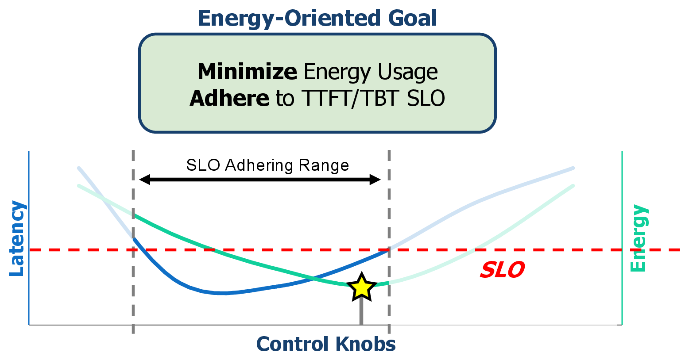
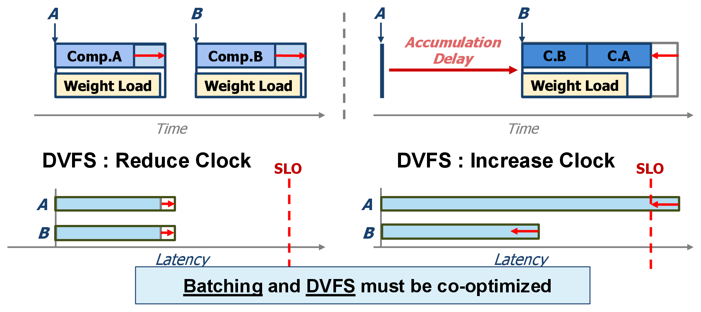
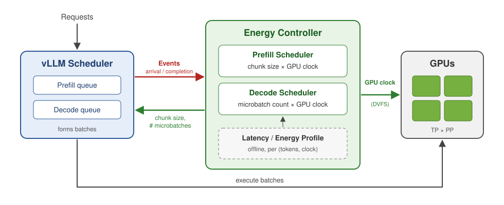

# Joint GPU Frequency and Batching Control for LLM Inference

An event-driven controller built into [vLLM](https://github.com/vllm-project/vllm). It adjusts **GPU frequency (DVFS)** together with **prefill chunk size** and **microbatch count** so that LLM serving uses as little energy as possible while still meeting latency SLOs.

<table>
<tr>
<td align="center"><b>51%</b> less GPU energy than vLLM</td>
<td align="center"><b>30%</b> less energy than a DVFS baseline</td>
<td align="center"><b>94.9% / 94.5%</b> TTFT / TBT SLO attainment</td>
</tr>
</table>

Llama-3.3-70B-Instruct on 8× A100-80GB (TP=2, PP=4), 1-hour production-style trace.

---

## The Problem

LLM serving does not need the *lowest* possible latency. It needs to meet a per-request deadline: **TTFT** (time to first token) and **TBT** (time between tokens). Any time left between "fastest possible" and "deadline" is **slack**, and slack can be spent to save energy.

The goal therefore shifts from *minimize latency* to *minimize energy while staying under the SLO line* (the ★ above).

## Key Insight: Batching and DVFS Are Coupled

Energy = **Power × Time**, so there are two ways to save it:

- **Batching** cuts *time*. Grouping requests shares the cost of loading the model weights, but requests have to wait for the batch to fill.
- **DVFS** cuts *power*. Lowering the GPU clock draws less power, but each step runs slower.

Both options spend **the same slack budget**, and they interact: the energy-optimal clock depends on how large the batch is. Today's systems tune one knob while holding the other fixed, so they reach only a local optimum.

## Three Control Knobs

The controller works at millisecond granularity with three knobs that are cheap to change:

| Knob | Phase | Larger value → |
| --- | --- | --- |
| **Chunk size** | Prefill | Better GPU efficiency (less energy), but bigger pipeline bubbles (higher TTFT/TBT) |
| **Microbatch count** | Decode | Better pipeline utilization (lower TBT), but each microbatch is less efficient (more energy) |
| **GPU clock (DVFS)** | Both | Lower latency, but higher power. Energy follows a "valley" curve whose lowest point shifts with the batch |

## How It Works

The controller sits inside vLLM's scheduler and runs only when the system state changes: a new request arrives or a request finishes. On each event, it searches over chunk size, microbatch count, and GPU clock. For each option it predicts TTFT, TBT, and energy from a small offline profile of per-step latency and energy, then picks the lowest-energy setting that still meets both SLOs. Prefill and decode have separate schedulers because they have different bottlenecks and different SLOs. Batching changes go back into vLLM's scheduler. The new clock is set through NVML on a background thread, so GPU execution never waits on a control decision.

## Results

**Setup:** Llama-3.3-70B-Instruct on 8× A100-80GB (TP=2, PP=4), and Qwen2.5-32B on 4× A100-80GB (TP=2, PP=2). The workload is a 1-hour bursty trace based on Alibaba ServeGen. The SLOs are TTFT ≤ 1 s and TBT ≤ 200 ms. The baselines are unmodified **vLLM** and **Window-DVFS**, which re-tunes the GPU clock every 5 s based on recent load (DynamoLLM-style).

| Setup | Energy vs. vLLM | Energy vs. Window-DVFS | TTFT SLO | TBT SLO |
| --- | --- | --- | --- | --- |
| Llama-3.3-70B, 8×A100 | **−51%** | **−30%** | 94.9% | 94.5% |
| Qwen2.5-32B, 4×A100 | **−47%** | −13% | 98.2% | 100% |

## Where the Code Lives

| Path | What it does |
| --- | --- |
| [vllm/v1/core/sched/scheduler.py](vllm/v1/core/sched/scheduler.py) | Event hooks plus the prefill and decode schedulers inside vLLM's V1 scheduler |
| [vllm/v1/core/sched/energy_model.py](vllm/v1/core/sched/energy_model.py) | Predictive latency and energy model built from offline profiles |
| [vllm/v1/core/sched/dynamo_energy_model.py](vllm/v1/core/sched/dynamo_energy_model.py) | Window-DVFS baseline (DynamoLLM-style) |

## License

This project is a fork of vLLM and inherits its [Apache 2.0 license](LICENSE).
